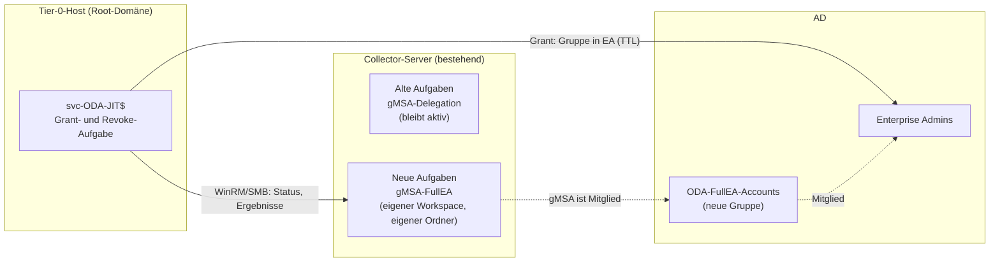

# FullEA-JIT parallel zur Delegations-Variante – Plan

Stand: 2026-10-20. Grundlage: [ODA-JIT-Deployment.de.md](ODA-JIT-Deployment.de.md) und
[PAM-Trust-Shadow-Principals.de.md](PAM-Trust-Shadow-Principals.de.md).

## 1. Ziel und Rahmenbedingungen

| Punkt | Festlegung |
| ----- | ---------- |
| Umfang | ODA **AD Assessment** und **AD Security Assessment** (beide) |
| Collector | Bestehender on-prem Member-Server, in Azure bekannt (Arc), mit einem Workspace des Kunden verbunden |
| Bestehende Variante | Delegation mit gMSA, Lauf alle 7 Tage. Bleibt unverändert aktiv |
| Neue Variante | FullEA-JIT mit **neuem, zweitem gMSA** auf **demselben** Collector |
| Umstellung | Alte Aufgabe wird **nicht gelöscht**, sondern erst nach erfolgreicher FullEA-Abnahme **deaktiviert** |
| Tier-Modell | Auf Member-Servern dürfen sich keine EA/DA anmelden. Dafür sind GPO-Ausnahmen oder Filter nötig (Abschnitt 4) |

## 2. Zielbild


<!-- docx-alt: Der Ausführer auf dem Tier-0-Host nimmt die neue Gruppe ODA-FullEA-Accounts zeitgebunden in Enterprise Admins auf und überwacht per WinRM und SMB nur die neuen Aufgaben auf dem Collector. Die alten Delegations-Aufgaben laufen unverändert weiter. -->

## 3. Wichtige Punkte vor dem Start

### 3.1 Zwei Instanzen auf einem Collector

| # | Thema | Folge | Maßnahme |
| - | ----- | ----- | -------- |
| 1 | Die ODA-Aufgaben heißen immer `ADAssessment` und `ADSecurityAssessment`. Der Task-Ordner enthält die Workspace-ID (Ist-Stand beim Kunden: `\Microsoft\Operations Management Suite\AOI-<WorkspaceId>\Assessments\<Assessment>\`, Konto der bestehenden Aufgaben ist das Delegations-gMSA) | Bisher filterten die JIT-Skripte **nur nach dem Namen**. Mit `-StartOdaTasks` würde auch die alte Aufgabe starten, der Watcher würde auf beide warten | **Umgesetzt:** Config-Feld `OdaTaskPath` (Abschnitt 6) |
| 2 | Gleicher Workspace für beide Instanzen | Gleicher `AOI-<WorkspaceId>`-Ordner und gleiche Namen, die alte Aufgabe würde kollidieren | **Neuer LAW** für FullEA, dessen WorkspaceId am Engage-Center-Connector hinzugefügt wird. Dadurch entsteht ein **neuer** `AOI-<GUID>`-Ordner |
| 3 | `OMSAssessment.exe` ist nicht pro Instanz unterscheidbar | Läuft der alte Lauf gleichzeitig, verzögert sich das Revoke (die Deadline greift trotzdem) | **Andere Wochentage** für die Läufe |
| 4 | Beide gMSAs auf einem Server | Das alte gMSA darf nie in die JIT-Gruppe | **Eigene** Gruppe für das neue gMSA |

### 3.2 Ablauf für den neuen Workspace

1. Neuen **LAW** für FullEA anlegen (öffentlicher Netzwerkzugriff, eigener Ressourcen-Ordner).
2. Im Engage-Center-Connector die neue **WorkspaceId** hinzufügen (Manage Connections).
3. Auf dem Collector die FullEA-Assessments mit dem neuen Workspace und eigenem `-WorkingDirectory`
   unter dem **neuen gMSA** anlegen. Dabei entsteht ein neuer `AOI-<GUID>`-Ordner.
4. Mit dem Befehl unten den neuen Ordner ermitteln und als `OdaTaskPath` eintragen.

```powershell
Get-ScheduledTask -TaskPath '\Microsoft\Operations Management Suite\*' |
    Select-Object TaskPath, TaskName, @{ n = 'RunAs'; e = { $_.Principal.UserId } }
```

Erwartet: **vier** Aufgaben, zwei im alten `AOI-…`-Ordner (Delegations-gMSA), zwei im neuen
(FullEA-gMSA). Bleibt der alte Ordner unverändert, ist die Parallelität bestätigt. Fällt das Ergebnis
anders aus (zum Beispiel Überschreiben), ist ein zweiter Collector die Rückfalloption.

## 4. GPO und Tier-Modell

Die Tier-Policy darf Anmeldungen von EA/DA auf Member-Servern verbieten. Für FullEA gelten
dennoch drei Sonderfälle.

### 4.1 Collector (Member-Server)

| Recht | Wirkung auf FullEA | Vorgehen |
| ----- | ------------------ | -------- |
| „Anmelden als Stapelverarbeitungsauftrag verweigern“ (Deny batch) | Das neue gMSA hat im Fenster ein EA-Token. Ein Deny auf EA blockiert den Task-Start (0x80070569) | Auf dem Collector **kein** Deny für EA. Stattdessen die **Allow-Liste** für „Log on as a batch job“ auf die ODA-gMSAs und Standard-Admins beschränken |
| „Zugriff vom Netzwerk verweigern“ (Deny network) | Der Ausführer braucht WinRM (5985) und SMB (445) | Root-DA/EA hier **nicht** verbieten. Zugriff über die Firewall auf den Tier-0-Host begrenzen |
| „Lokal anmelden“ / „RDP verweigern“ | Schützt vor Credential-Exposure | **Beibehalten.** Niemand von Tier-0 meldet sich interaktiv an |
| Lokale Administratoren | Der Ausführer braucht lokale Adminrechte (WinRM/CIM und `C$`) | Per GPO (Restricted Groups oder Preferences) nur `svc-ODA-JIT$` und die Collector-Admins |

Technisch umsetzen:

1. **Eigene OU und GPO** für den Collector.
2. Die Tier-Deny-GPO über **Security Filtering** („Deny Apply“ für das Collector-Computerkonto)
   ausnehmen. Das funktioniert auch bei einer **Enforced** GPO, Block Inheritance nicht.
3. Alternativ eine **Ausnahme in der Tier-GPO** nur für den Collector (WMI-Filter auf den Hostnamen).
4. Prüfen mit `gpresult /h` und Event 4625 (Fehlgrund `0xC000015B`).

> Im Fenster (ca. 1,5 h) liegt ein EA-Token im LSASS des Collectors. Ein Lokaladmin könnte es
> abgreifen. Der Collector ist in dieser Zeit praktisch Tier-0 und muss entsprechend gehärtet sein:
> nur ODA, EDR aktiv, wenige Tier-1-Admins, keine RDP-Sitzungen im Fenster.

### 4.2 Tier-0-Host

- Eigene Tier-0-OU. Anmelden dürfen nur Tier-0-Admins.
- `svc-ODA-JIT$` braucht „Log on as a batch job“. Dort darf kein Deny dafür stehen.
- Kein Internet, kein Browser. EDR und Patching wie bei DCs.

### 4.3 Rollen

| Rolle | Aufgaben |
| ----- | -------- |
| Tier-0-Admin | AD-Objekte (`svc-ODA-JIT$`, Gruppe), Tier-0-Host, Skripte, PAM-Feature |
| Tier-1-Admin | Collector: neues gMSA installieren, zweite ODA-Instanz, lokale Admin-Gruppe |
| GPO-Team | OU, Security Filtering, Rechtezuweisungen |

## 5. Phasenplan

| Phase | Inhalt | Wer |
| ----- | ------ | --- |
| 0 | Fragen klären (Abschnitt 8). Neuen LAW anlegen und am Connector hinzufügen (3.2) | Wir + Kunde |
| 1 | Tier-0-Host bereitstellen, härten, `RSAT-AD-PowerShell` installieren. Firewall: 9389 zur Root-DC und den GCs im Collector-Standort, 5985/445 zum Collector | Tier-0-Admin |
| 2 | AD-Objekte: `svc-ODA-JIT$` (Root-Domain-Admin), **neue** Gruppe `ODA-FullEA-Accounts`, **neues** Assessment-gMSA (Collector in `PrincipalsAllowedToRetrieveManagedPassword`). Optional PAM-Feature aktivieren | Tier-0-Admin |
| 3 | GPO nach Abschnitt 4 (Collector-OU, Security Filtering, Allow-Listen, lokale Admins) | GPO-Team |
| 4 | Collector: neues gMSA installieren (`Test-ADServiceAccount`), zweite ODA-Instanz mit neuem Workspace und eigenem Ordner (z. B. `C:\Assessments-FullEA`), **anderer Wochentag** als die Delegations-Aufgaben, beide FullEA-Aufgaben am selben Tag. Im Engage Center den neuen Workspace verbinden | Tier-1-Admin |
| 5 | Skripte (`OdaTaskPath` ist umgesetzt): die sechs Dateien nach `C:\ODA-JIT` auf den Tier-0-Host kopieren, `ODAJit.<forest>.psd1` mit dem **neuen** `AOI-<GUID>`-Ordner als `OdaTaskPath` anlegen | Wir |
| 6 | Probelauf (Guide Schritt 7, ohne Änderungen), dann `Register-ODAJitTasks.ps1` | Wir |
| 7 | Erster echter Lauf mit `-StartOdaTasks`. Events 1000 bis 1010 prüfen. Die alte Aufgabe läuft an ihrem Tag unverändert weiter | Wir |
| 8 | Abnahme: mindestens zwei FullEA-Läufe, Vergleich mit dem Delegationslauf (Zeilen je Sheet, siehe Abschnitt 7) | Wir + Kunde |
| 9 | **Alte Aufgaben deaktivieren** (`Disable-ScheduledTask`, nicht löschen). Delegationsrechte noch eine Zeit als Fallback belassen, danach mit `-operation delete` zurückbauen | Kunde |

## 6. Code-Anpassung `OdaTaskPath` (umgesetzt, 39 Pester-Tests grün auf PS 7 und 5.1)

| Datei | Änderung |
| ----- | -------- |
| `ODAJit.Common.psm1` | Neues optionales Feld `OdaTaskPath` (Standard leer = wie bisher nur Name), normalisiert auf `\…\`. Neue Funktion `Select-ODAJitTask` (Name + Ordner-Präfix, ohne Wildcards, Groß-/Kleinschreibung egal), genutzt von `Get-ODACollectorState` |
| `Start-ODAJitGrant.ps1` | Vorprüfung und `-StartOdaTasks` nutzen `Select-ODAJitTask` |
| `Start-ODAJitRevokeWatcher.ps1` | Über `Get-ODACollectorState` ebenfalls gefiltert |
| `Register-ODAJitTasks.ps1` | Trigger-Vergleich nur für die Aufgaben der FullEA-Instanz |
| `ODAJit.example.psd1` | Feld mit Kommentar |
| `Tests\ODAJit.Common.Tests.ps1` | Neue Tests: Normalisierung, Rückwärtskompatibilität, Ordnerfilter, Groß-/Kleinschreibung, Klammern als Literal |
| Deployment-Guide EN/DE | Schritt 5: Tabellenzeile und Abschnitt „Parallelbetrieb“. Das `.docx` ist noch nicht neu erzeugt |

Der Prozesscheck (`OMSAssessment.exe`) bleibt instanzübergreifend. Daher verschiedene Wochentage.

## 7. Abnahmekriterien

| Kriterium | Prüfung |
| --------- | ------- |
| Beide FullEA-Aufgaben laufen erfolgreich | Events 1000 bis 1010 (Quelle `ODA-JIT`) |
| EA nur im Fenster | 4756/4757: Aufnahme vor dem Lauf, Entzug nach dem Lauf (Event 1011) |
| Ergebnisqualität | Zeilen je Sheet im FullEA-Workbook gegenüber dem Delegations-Workbook, keine leeren Sheets |
| Alte Aufgabe unberührt | Delegationslauf an seinem Tag unverändert erfolgreich |
| Kein EA-Rest | Nach dem Fenster keine EA-Mitgliedschaft der Gruppe, Deadline-Backstop (Event 1012) nur im Fehlerfall |
| SIEM | Alarme für 4756/4757 außerhalb des Fensters oder durch ein anderes Konto als `svc-ODA-JIT$` |

## 8. Fragen für den Kunden

1. Welche Konten und Ordner haben die bestehenden Aufgaben? (**beantwortet:** ein `AOI-<GUID>`-Ordner, Delegations-gMSA)
2. Darf ein **neuer LAW** für FullEA angelegt werden? (**vorgesehen**)
3. Wie viele Forests und Domänen gibt es? Pro Forest brauchen wir Tier-0-Host, Ausführer und Konfiguration.
4. In welcher Domäne steht der Collector, gibt es ein Tier-0-Management-System in der Root-Domäne?
5. Darf ein dauerhaftes Tier-0-Konto `svc-ODA-JIT$` (Root-Domain-Admin) angelegt werden? Freigabe der
   Sicherheitsabteilung?
6. Ist das PAM-Feature (Optional Feature) aktiv? Ohne PAM gilt `UsePamTtl = $false`.
7. Wie sind die Tier-GPOs gebaut (Link-Ebene, **Enforced**, Deny-Rechte)? Welche Variante für den Collector:
   Security Filtering oder Ausnahme in der Tier-GPO?
8. Gibt es eine SIEM-Anbindung für 4756/4757 und `ODA-JIT`?
9. Wie lange soll die Delegations-Variante als Fallback bleiben?
10. Welche Wochentage und Uhrzeiten sind für FullEA frei?

## 9. Risiken

| Risiko | Gegenmaßnahme |
| ------ | ------------- |
| Zweite ODA-Instanz kollidiert mit der ersten (Name oder Workspace) | Phase-0-Test, eigener Workspace, eigener Ordner. Rückfall: zweiter Collector |
| Tier-GPO blockiert den Task-Start des neuen gMSA | GPO nach Abschnitt 4, Prüfung mit Event 4625 vor dem ersten Lauf |
| EA-Token liegt im Fenster auf dem Collector | Härtung, kurzes Fenster, TTL und Deadline als Backstop |
| Dauerhaftes Tier-0-Konto `svc-ODA-JIT$` | Nur ein Konto, nur auf einem Host nutzbar, Anmeldung interaktiv verweigert, SIEM-Überwachung |
| Alte und neue Aufgabe laufen gleichzeitig | Verschiedene Wochentage |
